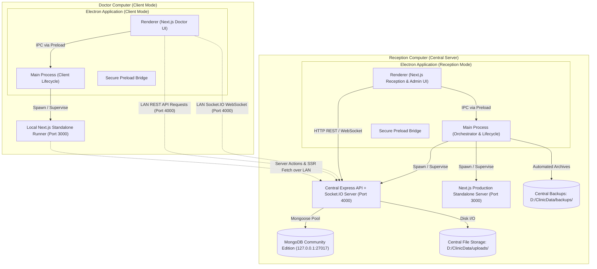

# Phase 2: Target Desktop Architecture Specification

**Document:** `specs/02-target-architecture.md`  
**Purpose:** Define the complete architectural blueprint for converting the Clinic Management System into a multi-computer Windows Desktop Application.

---

## 1. High-Level System Architecture

The clinic system operates across two physical computers on a Local Area Network (LAN):

1. **Reception Computer (Central Server Mode):**
   - Hosts MongoDB Community Edition (bound to `127.0.0.1:27017`).
   - Hosts the central Node.js + Express 5.3 REST API (listening on `0.0.0.0:4000`).
   - Hosts the Socket.IO Real-Time Server (attached to Express HTTP server).
   - Hosts the Local Central File Storage directory (`D:/ClinicData/uploads/`).
   - Runs the Electron Desktop Application (Receptionist / Admin UI).
   - Executes automated and manual backup jobs to `D:/ClinicData/backups/`.

2. **Doctor Computer (Client Mode):**
   - Runs the Electron Desktop Application (Doctor UI).
   - Connects to the Reception Computer via LAN IP (e.g. `http://192.168.1.50:4000/api/v1`).
   - Subscribes to the central Socket.IO server for real-time events.
   - Uploads and downloads attachments directly via central Express endpoints.
   - **Contains NO local MongoDB instance and NO independent database backend.**



---

## 2. Electron Process Architecture & Security Rules

Security is the foremost design constraint. The application strictly follows Electron security recommendations:

```
+-------------------------------------------------------------------------+
|                              RENDERER PROCESS                           |
|  - contextIsolation: true                                               |
|  - nodeIntegration: false                                               |
|  - sandbox: true                                                        |
|  - Web UI: React 19 + Next.js App Router                                |
|  - Talks ONLY to window.electronAPI and HTTP/WS endpoints               |
+------------------------------------+------------------------------------+
                                     | (Strict contextBridge whitelist)
                                     v
+-------------------------------------------------------------------------+
|                              PRELOAD SCRIPT                             |
|  - contextBridge.exposeInMainWorld('electronAPI', { ... })              |
|  - Strictly typed, sanitized IPC invocations                            |
|  - ZERO exposure of require(), child_process, or filesystem             |
+------------------------------------+------------------------------------+
                                     | (ipcRenderer.invoke / ipcRenderer.on)
                                     v
+-------------------------------------------------------------------------+
|                               MAIN PROCESS                              |
|  - Process lifecycle management (launch, restart, exit)                 |
|  - Child process daemon supervisor (Express & Next.js)                  |
|  - Local hardware & OS integration (Printing, System Tray, LAN IP)      |
|  - Native dialogs (file picker, backup destination picker)              |
+-------------------------------------------------------------------------+
```

### 2.1 Electron Main Process Responsibilities
1. **Mode Detection & Configuration Loading:** Reads `clinic-config.json` from `%APPDATA%/ClinicManagement/` to determine operating mode (`server` vs `client`).
2. **Subprocess Supervision (Server Mode):**
   - Checks if MongoDB service is active; if not, attempts starting it or alerts the user with actionable instructions.
   - Spawns and manages the Express API server process (`dist/src/server.js`) on port 4000.
   - Spawns and manages the Next.js standalone server on port 3000.
   - Monitors child processes; if an unexpected crash occurs, attempts clean restart and logs diagnostics.
3. **Subprocess Supervision (Client Mode):**
   - Configures the local Next.js client instance with `API_URL=http://<RECEPTION_IP>:4000/api/v1`.
   - Checks LAN reachability to the Reception Computer before opening the main window.
4. **Window Management:**
   - Creates a maximized, secure `BrowserWindow` loading `http://localhost:3000`.
   - Intercepts external links to open in the system default browser.
   - Handles graceful shutdown: signals `SIGTERM` to child processes, closes DB connections, and shuts down cleanly.
5. **Native Printing:** Exposes silent or dialog-driven printing for prescriptions, receipts, and daily closing statements.

### 2.2 Electron Preload Process (`preload.ts`)
The preload bridge exposes a strongly typed interface `window.electronAPI`:
```typescript
export interface IElectronAPI {
  // App & Environment Info
  getAppMode: () => Promise<'server' | 'client' | 'unconfigured'>;
  getAppVersion: () => Promise<string>;
  getLanIpAddresses: () => Promise<string[]>;
  
  // Server Status & Diagnostics
  getServerStatus: () => Promise<{
    apiOnline: boolean;
    dbConnected: boolean;
    socketActive: boolean;
    activeClientsCount: number;
    centralIp: string;
  }>;
  
  // Network Configuration
  saveNetworkConfig: (config: {
    mode: 'server' | 'client';
    serverIp: string;
    serverPort: number;
  }) => Promise<{ success: boolean; message?: string }>;
  
  // Backup Management (Server Mode Only)
  triggerBackup: (customDestination?: string) => Promise<{ success: boolean; archivePath?: string; error?: string }>;
  restoreBackup: (archiveFilePath: string) => Promise<{ success: boolean; error?: string }>;
  selectDirectory: () => Promise<string | null>;
  selectFile: (filters: Array<{ name: string; extensions: string[] }>) => Promise<string | null>;
  
  // Native Printing
  printReceipt: (htmlContent: string) => Promise<boolean>;
  printPrescription: (htmlContent: string) => Promise<boolean>;
}
```

### 2.3 Renderer Process Rules
- The renderer contains zero direct Node.js or Mongoose database logic.
- All data operations are performed via authenticated REST API calls and real-time Socket.IO subscriptions.
- Security tokens (`accessToken`) are kept secure; user credentials are never logged or stored in plain text.

---

## 3. Subsystem Integration Specifications

### 3.1 Next.js Frontend Integration
- **Build Strategy:** The Next.js frontend in `next/` is built using Next.js standalone output mode:
  ```ts
  // next.config.ts
  const nextConfig: NextConfig = {
    output: 'standalone',
    // ...
  };
  ```
  The standalone build bundles all necessary node modules and server components into `.next/standalone`, resulting in a lean, self-contained server that Electron executes via Node.
- **Port Strategy:**
  - Standard port: `3000` (dynamic fallback to `3001-3010` if 3000 is occupied).
- **Environment Injection:**
  - In Server Mode: `API_URL=http://localhost:4000/api/v1`
  - In Client Mode: `API_URL=http://<RECEPTION_LAN_IP>:4000/api/v1`

### 3.2 Central Express API Integration
- Express 5.3 runs on Node.js, listening on `0.0.0.0:4000` on the Reception Computer.
- CORS configuration dynamically allows:
  - `http://localhost:3000` (Local Reception UI)
  - `http://<DOCTOR_IP>:*` and LAN subnets (`192.168.1.0/24`, `10.0.0.0/8`, `172.16.0.0/12`).
- Static / Protected Attachment Streaming:
  - Serves files from `D:/ClinicData/uploads/` via authenticated route `/api/v1/attachments/file/:filename`.

### 3.3 MongoDB Community Edition Integration
- **Installation:** MongoDB Community Server (v7.x or v8.x) runs as a persistent Windows Service (`MongoDB`).
- **Network Restriction (Crucial Security Principle):**
  - MongoDB `mongod.cfg` is strictly configured with `bindIp: 127.0.0.1`.
  - Under NO circumstances is port 27017 exposed to the external network or LAN.
  - Doctor PC communicates ONLY through the authenticated Express REST API on port 4000.
- **Data Location:** Configured to store databases at `D:/ClinicData/database/`.

### 3.4 Socket.IO Real-Time Engine
- Attached directly to the Express HTTP server instance on Reception.
- Uses JWT / ticket authentication on handshake.
- Dispatches event updates on:
  - Queue changes (`queue:updated`, `queue:next_patient`).
  - Appointment bookings & cancellations (`appointment:created`, `appointment:status_changed`).
  - Doctor status transitions (`doctor:status_changed`).
  - Clinical examination completions (`examination:completed`).
- Automatic client reconnect with heartbeat every 10 seconds.

### 3.5 Local File Storage System
- Root folder: `D:/ClinicData/uploads/`
- Subfolders:
  - `patients/`: Patient identification photos, insurance cards.
  - `prescriptions/`: Exported prescription PDF copies.
  - `reports/`: Lab analyses, radiology images, ultrasound scans.
  - `attachments/`: General appointment attachments and drawings.
- Uploads are processed via Multer disk storage directly on Reception.
- Files receive a unique UUID v4 filename and are validated via magic-bytes.

### 3.6 Backup & Recovery Architecture
- Integrated backup service combines:
  1. MongoDB dump of all collections (`users`, `patients`, `appointments`, `visits`, `prescriptions`, `payments`, `expenses`, `settings`, etc.).
  2. Recursive archive of `D:/ClinicData/uploads/`.
  3. Digital manifest with timestamps, version, and SHA-256 hash.
- Generates a self-verifying compressed archive (`.zip`) saved to `D:/ClinicData/backups/` or an external USB storage drive.

---

## 4. Hardware and System Minimum Requirements

| Component | Reception Computer (Server) | Doctor Computer (Client) |
|---|---|---|
| **OS** | Windows 10 / 11 64-bit | Windows 10 / 11 64-bit |
| **CPU** | Intel Core i3 / AMD Ryzen 3 (Quad Core) | Dual Core 2.0 GHz or higher |
| **RAM** | 8 GB RAM minimum (16 GB recommended) | 4 GB RAM minimum |
| **Disk Storage** | 256 GB SSD (with dedicated `D:` partition) | 128 GB SSD |
| **Network** | Gigabit Ethernet (recommended) or 5GHz Wi-Fi | Gigabit Ethernet or Wi-Fi |
| **Resolution** | 1920x1080 (Full HD recommended) | 1920x1080 (Full HD recommended) |

---

## 5. Architectural Quality Attributes & SLA

1. **Availability:** System functions 100% offline without requiring internet connection.
2. **Data Consistency:** Single source of truth (Reception MongoDB). Zero split-brain risk.
3. **Latency:** Local LAN API requests respond in < 25ms; Socket.IO event latency < 10ms.
4. **Resilience:** Automatic graceful reconnection upon transient network cable unplugging or Wi-Fi renegotiation.
5. **Confidentiality:** Patient data never leaves the clinic's local network perimeter.

