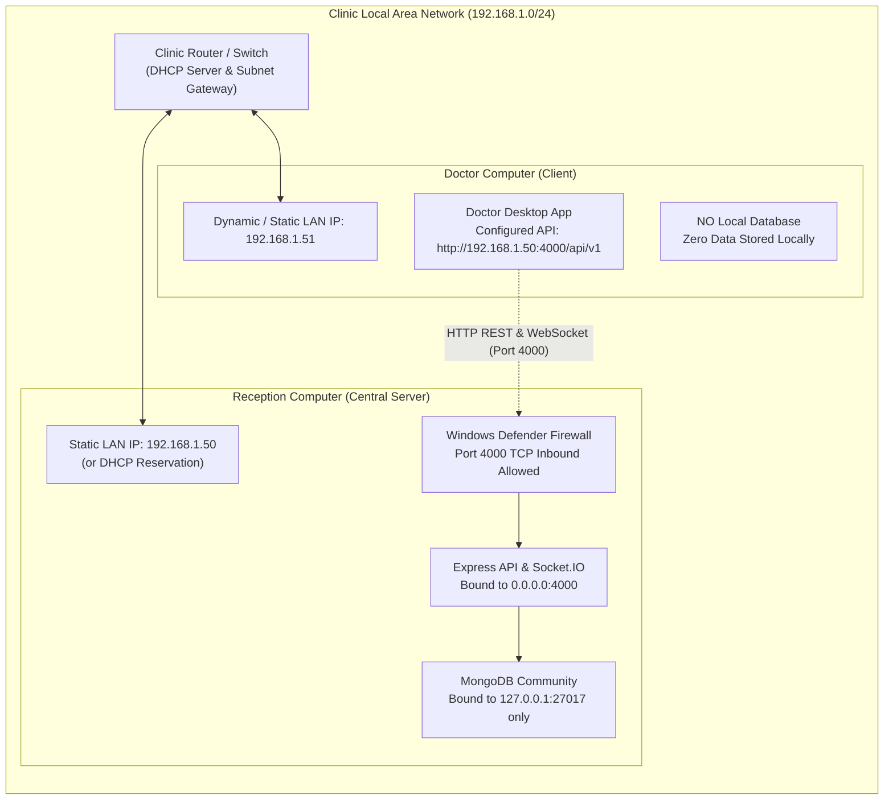
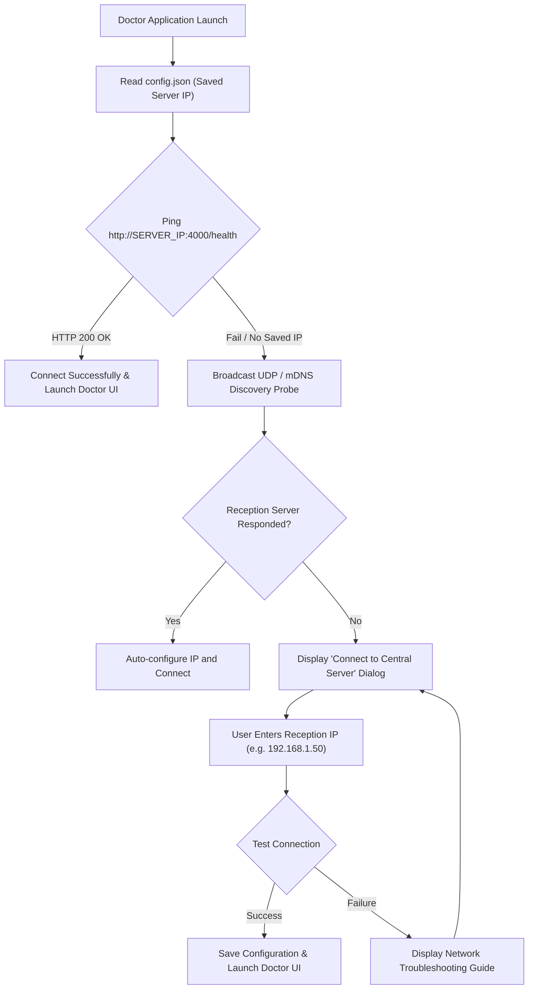
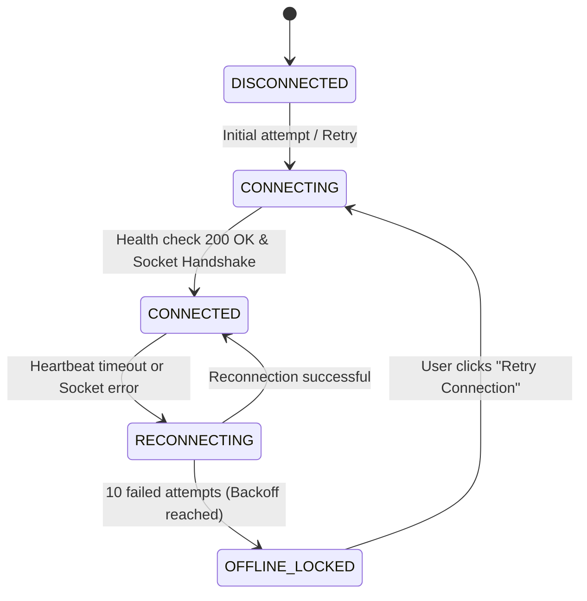

# Phase 2: Network & Multi-Computer Specification

**Document:** `specs/03-network-and-synchronization.md`  
**Purpose:** Specify network topology, LAN configuration, IP discovery, firewall rules, and fault-tolerant synchronization between Reception (Central Server) and Doctor (Client).

---

## 1. Network Topology & Addressing



### 1.1 IP Allocation Strategy
To ensure constant, uninterrupted communication:
1. **Reception Computer:** Assigned a dedicated static IP address (recommended: `192.168.1.50` or `10.0.0.50`) OR a DHCP reservation bound to its network card MAC address inside the clinic router.
2. **Doctor Computer:** Can use standard DHCP within the same subnet.
3. **Subnet Constraint:** Both computers must reside in the same physical or virtual subnet (e.g., `255.255.255.0`) with direct peer-to-peer TCP routing enabled (client isolation disabled on clinic Wi-Fi).

---

## 2. Ports and Binding Rules

| Service | Host Computer | IP Interface Binding | Port | Exposed to LAN? | Purpose |
|---|---|---|---|---|---|
| **Express REST API** | Reception | `0.0.0.0` (All interfaces) | 4000 | **YES** | Serving API requests from both Reception and Doctor PCs |
| **Socket.IO Realtime** | Reception | `0.0.0.0` (All interfaces) | 4000 | **YES** | WebSocket & Long-Polling bidirectional real-time events |
| **MongoDB Community** | Reception | `127.0.0.1` (Localhost only) | 27017 | **NO (STRICT)** | Database engine. External access blocked for security |
| **Next.js Frontend (Server)** | Reception | `127.0.0.1` | 3000 | **NO** | Local renderer for Reception/Admin UI |
| **Next.js Frontend (Doctor)** | Doctor | `127.0.0.1` | 3000 | **NO** | Local renderer for Doctor UI |

> [!CAUTION]
> **MongoDB Security Invariant:**
> Under no circumstances may `mongod` listen on `0.0.0.0` or allow direct connections from client computers. All interactions with data must occur through authenticated Express API routes enforcing business logic and RBAC.

---

## 3. Windows Firewall Configuration

For the Doctor Computer to communicate with the Reception Server, Windows Defender Firewall on the Reception Computer must permit inbound TCP traffic on port 4000.

### 3.1 Automated Firewall Configuration Script (PowerShell)
The desktop application installer executes the following PowerShell command during Reception Server installation:

```powershell
# Create Inbound Rule for Clinic API and Realtime Server
New-NetFirewallRule -DisplayName "Clinic Management System (Central Server)" `
    -Direction Inbound `
    -LocalPort 4000 `
    -Protocol TCP `
    -Action Allow `
    -Profile Private,Domain `
    -Description "Allows doctor workstations on clinic LAN to communicate with the central clinic server."
```

### 3.2 Verification Check
The Electron Main Process checks firewall and listening socket status at startup and alerts the user if port 4000 is blocked or inaccessible.

---

## 4. Central Server Discovery & Configuration

The application implements a multi-tier connection discovery mechanism:



### 4.1 Configuration File Format (`%APPDATA%/ClinicManagement/config.json`)
```json
{
  "mode": "client",
  "server": {
    "ip": "192.168.1.50",
    "port": 4000,
    "apiUrl": "http://192.168.1.50:4000/api/v1",
    "socketUrl": "http://192.168.1.50:4000",
    "requestTimeoutMs": 15000,
    "maxReconnectAttempts": 10
  },
  "client": {
    "stationName": "Doctor Examination Room 1",
    "lastConnectedAt": "2026-11-09T14:30:00.000Z"
  }
}
```

---

## 5. Network Failure Modes & Fault Tolerance

The application operates in a clinical environment where network cables may be dislodged or Wi-Fi temporarily disrupted. Resilience must be absolute.

### 5.1 Connection State Machine



### 5.2 Network Error Handling Strategy
1. **Request Timeout:** Set to 15,000ms. If the server does not respond within this window, the UI flags a timeout rather than hanging indefinitely.
2. **Reconnection with Exponential Backoff:**
   - Attempt 1: Immediate (1 second)
   - Attempt 2: 2 seconds
   - Attempt 3: 4 seconds
   - Attempt 4-10: 8 to 15 seconds
3. **Visual Connection Indicator:**
   - A persistent, discreet indicator in the top header:
     - 🟢 **Connected (متصل بالخادم المركزي)**: Normal real-time operation.
     - 🟡 **Reconnecting (جارٍ إعادة الاتصال بالخادم...)**: Shows an animated spinner; read actions queue or retry.
     - 🔴 **Disconnected (انقطع الاتصال بالخادم المركزي)**: Clear Arabic banner with a "تحقق من اتصال الشبكة / إعادة المحاولة" (Check network / Retry) button.
4. **Idempotency & Mutation Safety:**
   - Mutations (e.g., patient booking, payment checkout, prescription saving) carry an `idempotencyKey` (UUID). If a request drops mid-flight and is retried, the server will not create duplicate records.
5. **No Local Split-Brain Database:**
   - Under NO circumstance will the Doctor desktop spawn a local database or cache offline mutations to write later. A clinic cannot risk patient prescriptions or queue orders diverging between two conflicting databases.

---

## 6. Access Control & LAN Device Restriction

1. **Authentication Requirement:** Only authenticated requests carrying a valid JWT Bearer token issued by the Central Server can access protected endpoints.
2. **CORS Security:** Permitted origins are restricted to localhost and valid private IPv4 subnet patterns (`192.168.*`, `10.*`, `172.16-31.*`).
3. **No Direct Internet Exposure:** The router must NOT configure port forwarding (NAT) on port 4000. All operations remain strictly inside the physical clinic walls.

