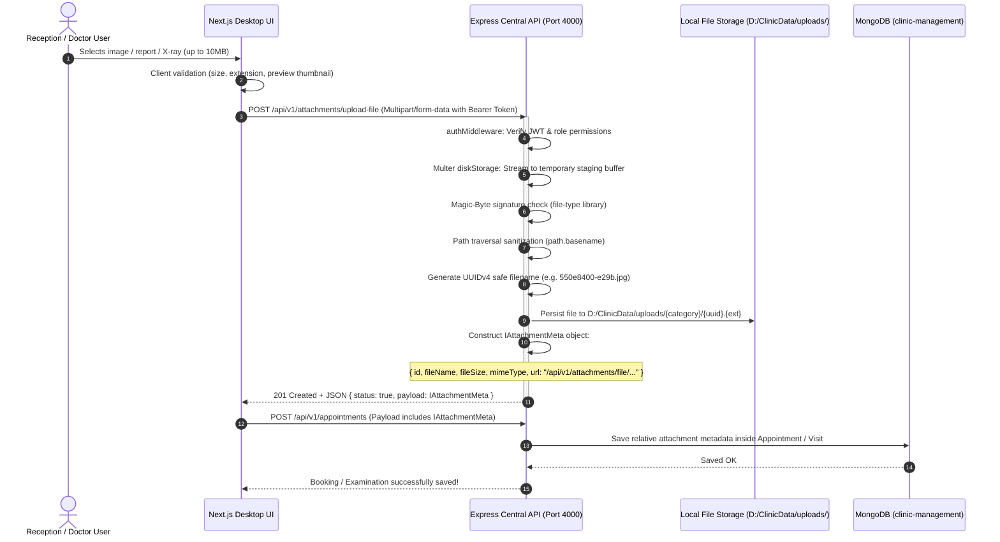

# Phase 2: Shared Files & Image Storage Specification

**Document:** `specs/04-file-storage.md`  
**Purpose:** Define the storage architecture for all clinic digital assets (patient images, medical reports, X-rays, prescriptions, and drawings) on the central Reception Computer with zero cloud reliance.

---

## 1. Directory Structure & Central Data Storage

All permanent clinic data resides in a dedicated directory on the Reception Computer's secondary drive (`D:`), ensuring that operating system updates or re-installations on `C:` will not endanger clinic records:

```
D:/ClinicData/
├── database/                    # MongoDB Community data files (wiredTiger)
│   ├── collection-*.wt
│   ├── index-*.wt
│   └── mongod.lock
│
├── uploads/                     # Central Clinic Files and Digital Assets
│   ├── patients/                # Patient profile photos & identification cards
│   ├── appointments/            # Attachments uploaded during booking
│   ├── prescriptions/           # Generated prescription PDFs & print archives
│   ├── reports/                 # Lab tests, ultrasound scans, radiology X-rays
│   └── examination/             # ENT diagrams, exported sketches, anatomical notes
│
├── backups/                     # Compressed timestamped backup archives
│   ├── auto/                    # Daily automated closing backups
│   └── manual/                  # On-demand backups and pre-upgrade snapshots
│
└── config/                      # Server configuration and clinic certificates
    └── clinic-config.json
```

> [!IMPORTANT]
> If a clinic machine possesses only a single physical partition (`C:`), the software transparently falls back to `C:/ClinicData/`, while creating a user warning recommending a secondary disk or external backup drive.

---

## 2. Eliminating Cloud S3 Dependencies

The existing codebase contained code targeting Tigris Data (S3) via `@aws-sdk/client-s3`. In the target desktop architecture:
1. **Total Cloud Removal:** The `storage.driver` is set to `local` disk storage permanently.
2. **Local Multi-Computer Access:** The Doctor Computer uploads files directly to the Reception Computer via HTTP Multipart POST requests over LAN.
3. **No Redundant Local Copies on Doctor PC:** The Doctor Computer streams files on-demand over LAN; it does not replicate or synchronize copies of the file tree locally.

---

## 3. Upload Architecture & Processing Pipeline



---

## 4. File Validation & Security Specifications

### 4.1 Permitted File Types and Magic Byte Verification
The server will not rely on the client-supplied MIME type or file extension. Instead, the first bytes of each upload are analyzed using `file-type`:

| Permitted Category | Allowed Extensions | Valid MIME Types | Verified Magic Bytes |
|---|---|---|---|
| **JPEG Images** | `.jpg`, `.jpeg` | `image/jpeg` | `FF D8 FF` |
| **PNG Images** | `.png` | `image/png` | `89 50 4E 47 0D 0A 1A 0A` |
| **WebP Images** | `.webp` | `image/webp` | `52 49 46 46 ... 57 45 42 50` |
| **PDF Documents** | `.pdf` | `application/pdf` | `25 50 44 46` (`%PDF-`) |

Any file whose magic bytes do not strictly match the whitelist will be rejected immediately with HTTP 400 (`نوع الملف غير صالح أو تم التلاعب به`).

### 4.2 File Size Limits
- Single file maximum: **10 MB** (10,485,760 bytes).
- Batch booking upload maximum: **5 files** per request (total maximum 30 MB).
- Requests exceeding these thresholds are aborted early using streaming limits before memory exhaustion occurs.

### 4.3 Safe Unique Filenames & Traversal Prevention
Files are never stored under user-submitted names:
```typescript
// Example Storage Controller Implementation
const fileId = uuidv4();
const sanitizedExtension = detectedType.ext; // Guaranteed from magic-bytes
const safeDiskFileName = `${fileId}.${sanitizedExtension}`;
const safeOriginalName = path.basename(req.file.originalname).substring(0, 100);

const destinationFolder = path.join(BASE_UPLOAD_DIR, targetCategory);
const fullDiskPath = path.join(destinationFolder, safeDiskFileName);

// Guarantee destination path is inside BASE_UPLOAD_DIR
if (!fullDiskPath.startsWith(BASE_UPLOAD_DIR)) {
  throw new ForbiddenError('Path traversal attempt detected');
}
```

---

## 5. Metadata Schema in MongoDB

Binary files are **never** stored inside regular MongoDB BSON documents. Instead, small, normalized metadata records are embedded within the relevant document:

```typescript
export interface IAttachmentMeta {
  id: string;               // UUIDv4
  category: 'patients' | 'appointments' | 'prescriptions' | 'reports' | 'examination';
  fileName: string;         // Original sanitized file name for user display (e.g. "XRay-Chest.png")
  storedFileName: string;   // On-disk UUID name (e.g. "9b1deb4d-3b7d-4bad-9bdd-2b0d7b3dcb6d.png")
  fileSize: number;         // Size in bytes
  mimeType: string;         // Verified MIME type (e.g. "image/png")
  url: string;              // Relative API route (e.g. "/api/v1/attachments/file/9b1deb4d-3b7d-4bad-9bdd-2b0d7b3dcb6d.png")
  uploadedById: string;     // User ID who performed the upload
  uploadedAt: Date;         // Timestamp
}
```

This ensures MongoDB documents remain fast, lightweight, and well under the 16MB BSON document size limit.

---

## 6. Doctor Computer Retrieval & Streaming

When a doctor opens a patient record, appointment history, or clinical examination on the Doctor Computer:

1. The Next.js UI receives the attachment URL from the API: `/api/v1/attachments/file/{storedFileName}`.
2. In Next.js Server Components, the server rewrites or fetches directly from `http://192.168.1.50:4000/api/v1/attachments/file/{storedFileName}`.
3. The Express controller on Reception verifies the requester's session token and streams the file using Node.js readable streams:
   ```typescript
   res.setHeader('Content-Type', mimeType);
   res.setHeader('Content-Length', stat.size);
   res.setHeader('Cache-Control', 'private, max-age=86400'); // Cache on client for 24h
   const readStream = fs.createReadStream(filePath);
   readStream.pipe(res);
   ```
4. Images and PDFs render smoothly with HTTP 206 Partial Content (Range requests) support for large medical PDFs.
5. If the connection drops mid-download, the client can resume automatically using standard HTTP range headers.

