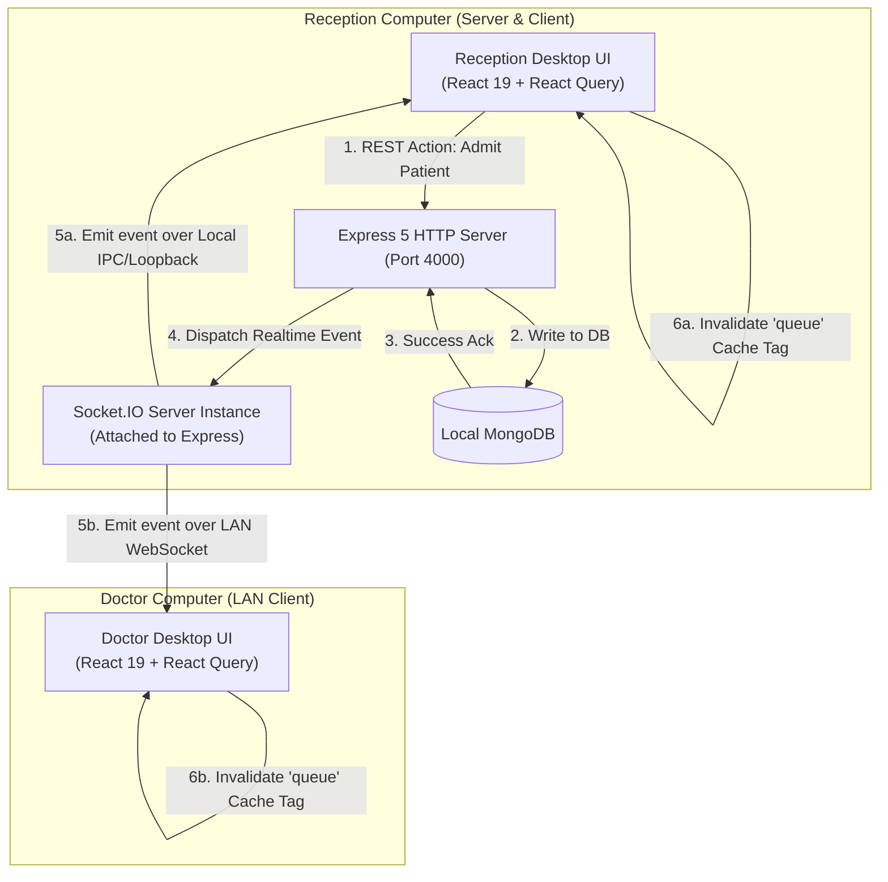

# Phase 2: Real-Time Communication Specification

**Document:** `specs/05-realtime-events.md`  
**Purpose:** Define the real-time event architecture, Socket.IO gateway, authentication handshake, event taxonomy, room-based isolation, and frontend React Query synchronization.

---

## 1. Real-Time Architecture Overview

In a dual-computer clinic setup, real-time synchronization prevents reception staff and doctors from operating on stale records. When Reception marks a patient as "Arrived in Waiting Room", the Doctor's queue screen must update within milliseconds. When the Doctor starts an examination, the Receptionist must immediately see the doctor's status change to "With Patient".



> [!IMPORTANT]
> **Persistence-First Invariant:**
> A real-time event is NEVER dispatched until the database mutation has successfully committed to MongoDB. Socket.IO is strictly a notification and synchronization bus; it is never a primary data store.

---

## 2. Authentication & Handshake Protocol

Socket.IO connections are protected against unauthorized LAN devices using the existing tokenized ticket mechanism:

1. **Ticket Request:** The client desktop makes an authenticated HTTP call:
   `POST /api/v1/auth/socket-ticket` (with `Authorization: Bearer <accessToken>`).
2. **Ticket Generation:** The server generates a high-entropy 32-byte UUID ticket valid for 30 seconds and associates it in-memory with the authenticated user's ID and role.
3. **Socket Handshake:** The client establishes a WebSocket connection passing the ticket in the handshake auth object:
   ```typescript
   import { io } from 'socket.io-client';

   const socket = io(process.env.NEXT_PUBLIC_SOCKET_URL || 'http://192.168.1.50:4000', {
     auth: { ticket: socketTicket },
     transports: ['websocket', 'polling'],
     reconnection: true,
     reconnectionAttempts: Infinity,
     reconnectionDelay: 1000,
     reconnectionDelayMax: 5000,
   });
   ```
4. **Server Verification:** The server middleware verifies the ticket, attaches user details to `socket.data.user`, immediately consumes/invalidates the ticket to prevent replay attacks, and admits the socket into role-specific rooms.

---

## 3. Room Hierarchy & Role-Based Isolation

To prevent reception staff from accidentally receiving sensitive clinical diagnosis payloads, events are partitioned into rooms:

| Room Name | Permitted Roles | Content / Scope |
|---|---|---|
| `clinic:global` | Admin, Doctor, Reception | General clinic alerts, doctor status changes (`AVAILABLE`, `BREAK`) |
| `clinic:queue` | Admin, Doctor, Reception | Waiting list movements, patient check-ins, queue call numbers |
| `clinic:medical` | Admin, Doctor | Medical examination updates, visit notes, clinical ENT diagrams |
| `clinic:finance` | Admin, Reception | Payment settlements, receipts, daily closing calculations |
| `user:{userId}` | Specific User | Direct personal notifications (e.g. session revocation) |

---

## 4. Event Taxonomy & Payload Definitions

### 4.1 Queue & Appointment Events
- **`queue:updated`**: Emitted whenever a patient arrives, is called, postponed, or checked out.
  ```json
  {
    "event": "queue:updated",
    "clinicDate": "2026-11-09",
    "doctorId": "d748f2a1-e018-45a7-9b7e-976c66cf1f40",
    "timestamp": "2026-11-09T14:32:00.000Z"
  }
  ```
- **`queue:next_patient`**: Emitted when the doctor calls the next patient.
  ```json
  {
    "event": "queue:next_patient",
    "appointmentId": "a1b2c3d4-...",
    "patientId": "p9988776-...",
    "patientName": "أحمد محمود محمد علي",
    "queueNumber": 7,
    "doctorId": "d748f2a1-..."
  }
  ```
- **`appointment:created`**: Emitted when Reception registers a new booking.
- **`appointment:status_changed`**: Emitted when an appointment transitions between `BOOKED`, `WAITING`, `IN_PROGRESS`, `PENDING_CHECKOUT`, `COMPLETED`, `CANCELLED`.

### 4.2 Doctor Status Events
- **`doctor:status_changed`**: Emitted when the doctor toggles availability or starts an exam.
  ```json
  {
    "event": "doctor:status_changed",
    "doctorId": "d748f2a1-...",
    "status": "WITH_PATIENT", // AVAILABLE | WITH_PATIENT | BREAK
    "updatedAt": "2026-11-09T14:35:10.000Z"
  }
  ```

### 4.3 Medical Examination Events (Restricted to `clinic:medical`)
- **`examination:started`**: Doctor begins consultation.
- **`examination:completed`**: Doctor finishes consultation and saves prescription.

### 4.4 Financial Events (Restricted to `clinic:finance`)
- **`payment:recorded`**: Payment settled at reception.
- **`closing:completed`**: Daily financial closing reconciled.

---

## 5. Frontend React Query Integration

Instead of manually mutating component state upon receiving socket events (which is brittle and prone to race conditions), the frontend leverages `@tanstack/react-query` cache invalidation:

```typescript
// Client-side real-time subscriber hook
export function useClinicRealtime() {
  const queryClient = useQueryClient();

  useEffect(() => {
    const socket = getSocketInstance();

    // 1. Queue updates -> Invalidate queue and appointment queries
    socket.on('queue:updated', () => {
      queryClient.invalidateQueries({ queryKey: queueKeys.all });
      queryClient.invalidateQueries({ queryKey: appointmentKeys.all });
    });

    // 2. Doctor status updates -> Invalidate doctor status badge
    socket.on('doctor:status_changed', ({ doctorId }) => {
      queryClient.invalidateQueries({ queryKey: doctorStatusKeys.detail(doctorId) });
      queryClient.invalidateQueries({ queryKey: doctorStatusKeys.all });
    });

    // 3. Next patient called -> Invalidate and play optional audible chime
    socket.on('queue:next_patient', (payload) => {
      queryClient.invalidateQueries({ queryKey: queueKeys.all });
      playChimeNotification();
    });

    return () => {
      socket.off('queue:updated');
      socket.off('doctor:status_changed');
      socket.off('queue:next_patient');
    };
  }, [queryClient]);
}
```

This guarantees:
1. Components automatically re-fetch the latest authoritative data from the REST API.
2. Zero risk of client state divergence or ghost records.
3. Loading skeletons and optimistic updates operate smoothly.

---

## 6. Disconnection Recovery & Fallback Strategy

1. **Heartbeat & Keep-Alive:** Ping interval: 10 seconds; Ping timeout: 5 seconds.
2. **On Disconnect:**
   - The UI displays a subtle reconnecting indicator.
   - A fallback polling interval (every 10 seconds) activates as a safety net if WebSockets are temporarily blocked.
3. **On Reconnection:**
   - The client fetches a fresh socket ticket.
   - Queries `queryClient.invalidateQueries()` across all active screens to synchronize any state changes that occurred during the network interruption.

