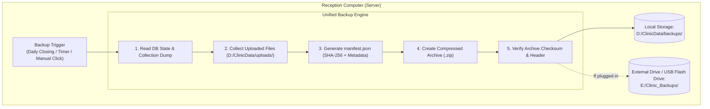
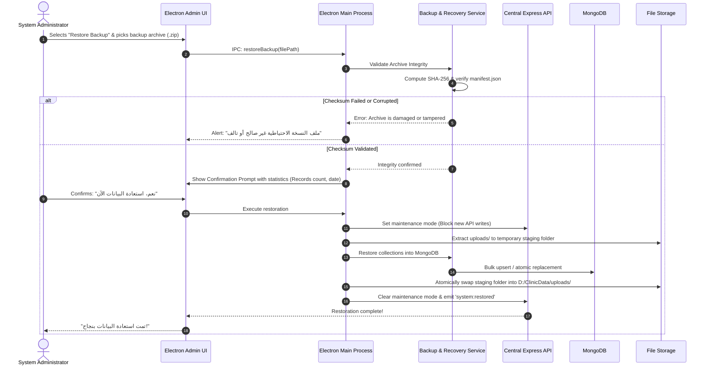

# Phase 2: Backup & Recovery Specification

**Document:** `specs/07-backup-and-recovery.md`  
**Purpose:** Specify coordinated backup of MongoDB database records and uploaded medical files, automated schedules, external drive export, integrity validation, and disaster recovery procedures.

---

## 1. Unified Backup Philosophy

Patient clinical records (MongoDB documents) and attached medical imagery / diagnostic reports (file storage) are interdependent. Restoring a database without its corresponding image files, or vice-versa, results in broken references and incomplete medical history.

Therefore, the backup engine enforces a **Unified Snapshot Guarantee**:
> Every backup snapshot packages the complete MongoDB database state AND all uploaded files at that exact moment into a single, self-describing, integrity-checked archive.



---

## 2. Backup Archive Structure

Each snapshot generates an archive named `clinic_backup_YYYY-MM-DD_HHmmss.zip`:

```
clinic_backup_2026-11-09_213000.zip
├── manifest.json              # Version, timestamp, statistics, and SHA-256 checksums
├── database/                  # MongoDB collection dumps (BSON / JSON)
│   ├── users.json
│   ├── patients.json
│   ├── appointments.json
│   ├── visits.json
│   ├── prescriptions.json
│   ├── payments.json
│   ├── expenses.json
│   ├── settings.json
│   ├── audit-logs.json
│   └── doctor-statuses.json
└── uploads/                   # Mirrored file storage hierarchy
    ├── patients/
    ├── appointments/
    ├── prescriptions/
    ├── reports/
    └── examination/
```

### 2.1 Manifest Schema (`manifest.json`)
```json
{
  "system": "Clinic Management Desktop",
  "version": "1.0.0",
  "backupId": "b8f041b6-7e3c-49a8-b649-0d2a84c13a29",
  "createdAt": "2026-11-09T21:30:00.000Z",
  "creatorUserId": "adm-001",
  "creatorUsername": "admin",
  "database": {
    "collectionsCount": 13,
    "recordsCount": 1845,
    "sha256": "8a35e482...e7f1"
  },
  "uploads": {
    "filesCount": 342,
    "totalSizeBytes": 158492040,
    "sha256": "c49b109e...92a1"
  },
  "archiveSha256": "5f1b802a...bb34"
}
```

---

## 3. Backup Execution Modes

### 3.1 Automated Scheduled Backups
1. **Daily Financial Closing Trigger:** When reception or admin submits the end-of-day register closing (`POST /api/v1/closing`), a background backup job triggers automatically.
2. **Nightly Cron/Timer:** Scheduled every night at 23:00 (11:00 PM) local clinic time if the system is running.

### 3.2 Manual On-Demand Backup
- Available to the `ADMIN` role via the desktop Admin dashboard or Electron system menu:
  - Button: "إنشاء نسخة احتياطية الآن" (Create Backup Now).
  - Dialog allows selecting an optional custom destination (e.g. an attached USB external hard drive or flash drive).

### 3.3 Retention Policy
To prevent disk exhaustion while safeguarding patient historical archives:
- **Daily Snapshots:** Retained for **30 days**.
- **Weekly / Monthly Snapshots:** Retained for **12 months**.
- **No Silent Deletions:** Old backups are moved to an `archive/` folder; deletion requires explicit administrative confirmation.

---

## 4. Disaster Recovery & Restoration Workflow

Restoration is a critical operation executed strictly under Administrative authorization:



### 4.1 Safety Guarantees during Restoration
1. **Pre-Restoration Snapshot:** Before executing any restore, the system automatically creates a safeguard snapshot of current data (`pre_restore_snapshot.zip`). If the user accidentally restored an old or incorrect file, they can revert immediately.
2. **Maintenance Mode:** During restoration, the Express server responds to non-admin requests with HTTP 503 (`النظام قيد استعادة البيانات مؤقتاً`).
3. **Atomic File Swapping:** Upload directories are extracted to a staging folder first; if extraction succeeds, the staging folder is moved into production, avoiding half-restored states.

---

## 5. Security of Backup Archives

1. **Patient Data Privacy:** Backup archives contain sensitive medical data and must not be accessible to unauthenticated local users.
2. **Access Control:** The `D:/ClinicData/backups/` directory is secured with Windows NTFS permissions permitting read/write access only to Administrators and the service user account.
3. **Audit Logging:** Every backup creation, export, and restoration action is recorded in the permanent audit trail.

