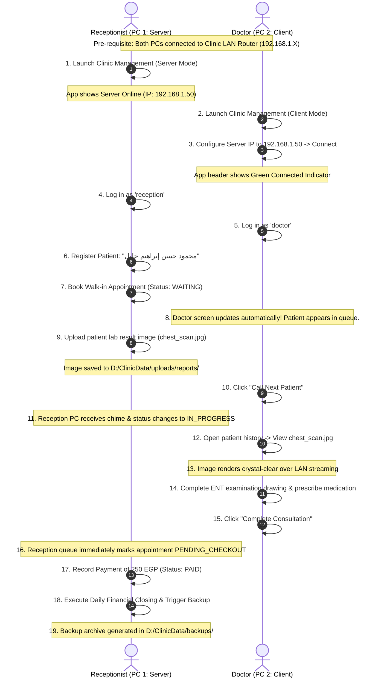

# Phase 2: Testing & Acceptance Criteria Specification

**Document:** `specs/09-testing-and-acceptance.md`  
**Purpose:** Define automated verification suites, end-to-end integration tests, fault-injection tests, and the 17-point manual acceptance testing protocol for the multi-computer LAN desktop deployment.

---

## 1. 17 Formal Acceptance Criteria

To declare the migration successful, the application must pass all seventeen formal acceptance criteria:

| # | Acceptance Criterion | Verification Method | Pass / Fail Status |
|---|---|---|---|
| **AC-01** | Reception Computer starts the central Express API & Socket.IO server. | Electron boot log + HTTP GET `/health` returning 200 OK. | Mandatory |
| **AC-02** | MongoDB Community Edition runs locally on Reception Computer (`127.0.0.1:27017`). | `mongosh --eval "db.adminCommand('ping')"` responds `{ ok: 1 }`. External port closed. | Mandatory |
| **AC-03** | Doctor Computer connects to Reception Server through LAN via IP (e.g. `192.168.1.50`). | Doctor app successfully reaches `/health` and establishes WebSocket handshake. | Mandatory |
| **AC-04** | Both computers authenticate independently with role-based JWT sessions. | Login as Receptionist on Reception PC; login as Doctor on Doctor PC. Sessions isolated. | Mandatory |
| **AC-05** | Receptionist creates a new patient with mandatory 4-part name. | Receptionist fills form and submits; patient document created in central MongoDB. | Mandatory |
| **AC-06** | Doctor immediately sees the newly created patient in search / queue without manual refresh. | Socket.IO emits event; Doctor UI invalidates React Query cache and renders patient in < 200ms. | Mandatory |
| **AC-07** | Receptionist uploads a patient image attachment (JPEG/PNG/WebP/PDF). | File saved to `D:/ClinicData/uploads/`; magic-bytes verified; metadata saved to MongoDB. | Mandatory |
| **AC-08** | Doctor views and downloads the exact same uploaded image over LAN. | Doctor clicks attachment; streamed via authenticated Express endpoint. No local duplicate. | Mandatory |
| **AC-09** | Doctor updates medical record (diagnosis, ENT examination drawing, prescription). | Doctor submits visit editor; visit updated with incremented version in MongoDB. | Mandatory |
| **AC-10** | Receptionist sees the updated status (consultation completed / pending checkout) immediately. | Realtime event triggers queue status change in Reception UI; financial checkout enabled. | Mandatory |
| **AC-11** | Real-time notifications & queue call chime work across LAN. | Doctor clicks "Call Next"; Reception UI displays visual alert and plays audio notification. | Mandatory |
| **AC-12** | Both computers access the identical database without data drift or split-brain. | Querying MongoDB directly confirms both client UIs reflect the exact same record IDs. | Mandatory |
| **AC-13** | Network disconnection is handled safely with clear user warnings and automatic reconnection. | Disconnecting LAN cable shows orange reconnecting banner; reconnecting cable resumes sync. | Mandatory |
| **AC-14** | Restarting the Central Server does not delete or corrupt patient data. | Windows reboot of Reception PC; data intact in `D:/ClinicData/`; services restart cleanly. | Mandatory |
| **AC-15** | Unified Backup and Restoration work correctly. | Snapshot created (`.zip`); test restoration restores collections and files accurately. | Mandatory |
| **AC-16** | Windows executable installer (`Clinic-Setup.exe`) builds and installs cleanly via NSIS. | Executable generated via electron-builder; installs, upgrades, and preserves patient data. | Mandatory |
| **AC-17** | Zero paid cloud hosting or monthly cloud database subscriptions required. | System runs completely disconnected from public internet (airplane mode on router). | Mandatory |

---

## 2. Automated Test Suites

### 2.1 Backend Unit & Integration Tests (Jest & Supertest)
```bash
cd server
npm run test
```
The backend test suite covers:
1. **API Response Contract (`api-contract.spec.ts`):** Validates standard `{ status, code, payload }` format.
2. **Error Handling (`errorHandler.spec.ts`):** Validates 400, 401, 403, 404, 422, and 500 responses.
3. **Arabic Normalization (`arabic.spec.ts`):** Validates normalization of Alef, Taa Marbuta, and 4-part name parser.
4. **Role Guards & RBAC:** Verifies doctor cannot access financial closing; reception cannot access medical records.
5. **Magic-Byte File Validation:** Verifies forged file extensions (e.g. an `.exe` renamed to `.jpg`) are rejected.
6. **Optimistic Locking:** Verifies concurrent visit edits throw `VERSION_CONFLICT` (HTTP 409).

### 2.2 Real-Time Socket.IO Integration Tests
Automated headless tests using `socket.io-client`:
1. Connecting without ticket -> Handshake rejected with `UNAUTHORIZED`.
2. Connecting with valid ticket -> Handshake accepted, assigned to role rooms.
3. Emitting `queue:updated` -> Verified received by subscribed sockets in room.

---

## 3. Manual Two-Computer LAN Testing Protocol

To verify the physical multi-computer setup in a clinical setting, follow this step-by-step protocol:



---

## 4. Fault-Injection & Resilience Tests

| Test Case | Injected Fault | Expected Behavior | Verification |
|---|---|---|---|
| **FIT-01** | Unplug LAN cable from Doctor PC during idle state. | Doctor app displays yellow "Connecting..." banner. No crash. | Plug cable back in -> Reconnects automatically within 3 seconds. |
| **FIT-02** | Unplug LAN cable from Doctor PC during patient form edit. | Form input remains preserved in memory. Saving button disabled with connection warning. | Plug cable back in -> Button re-enables -> Submits successfully. |
| **FIT-03** | Restart Reception Computer while Doctor PC is open. | Doctor app flags disconnection banner. Does not create local DB. | When Reception PC boots -> Doctor app reconnects automatically. |
| **FIT-04** | Disconnect router from Internet (Offline Test). | All operations (appointments, medical records, files, printing) proceed with zero degradation. | Confirms total offline self-sufficiency. |
| **FIT-05** | Attempt upload of 20MB file. | Rejected on client and server before disk write. | User alerted: "الحد الأقصى لحجم الملف هو 10 ميجابايت". |
| **FIT-06** | Attempt upload of renamed `.exe` as `.png`. | Magic-byte validator detects `MZ` header -> Rejects with 400. | Server logs security warning. |

