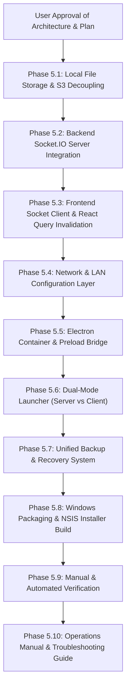

# Phase 3: Migration Risks & Step-by-Step Implementation Plan

**Document:** `specs/10-implementation-plan.md`  
**Purpose:** Detail technical risks, mitigation mechanisms, and an incremental step-by-step roadmap for executing the desktop conversion upon user approval.

---

## 1. Migration Risk Assessment & Mitigation Matrix

| Risk ID | Risk Description | Severity | Probability | Mitigation Strategy |
|---|---|:---:|:---:|---|
| **RSK-01** | **Cloud S3 Dependency Failure:** Existing upload logic attempts to call Tigris S3, failing when offline. | High | High | Completely replace S3 calls with local disk storage via Multer on Reception Computer (`D:/ClinicData/uploads/`). Verify magic-bytes locally. |
| **RSK-02** | **LAN Network IP Address Changes:** Router reboots and assigns a new dynamic IP to Reception, disconnecting Doctor PC. | High | Medium | 1. Provide instructions for setting a static LAN IP or router DHCP reservation. 2. Build automatic LAN discovery (UDP probe). 3. Provide an intuitive "Update Server IP" dialog in the Doctor app. |
| **RSK-03** | **Windows Defender Firewall Blocks Inbound Port 4000:** Doctor PC cannot connect to Reception Server. | High | Medium | Include automated PowerShell firewall rule creation in the desktop installer and startup verification diagnostics in the Main Process. |
| **RSK-04** | **Next.js App Router Standalone Bundling Issues in Electron:** Next.js uses dynamic imports, Server Actions, and NextAuth. | Medium | Medium | Use official `output: 'standalone'` mode in `next.config.ts`, bundle `.next/standalone` into Electron extra resources, and execute via Node child process. |
| **RSK-05** | **Race Conditions / Concurrent Visit Edits:** Both Doctor and Reception attempt to edit a patient record simultaneously. | Medium | Low | Enforce Mongoose optimistic concurrency locking (`version` field) on the `Visit` and `Appointment` models. Reject stale updates with HTTP 409. |
| **RSK-06** | **Database Data Loss During Application Updates:** Updating `Clinic-Setup.exe` might overwrite local databases. | Critical | Low | Maintain all databases and uploads strictly outside program directories at `D:/ClinicData/`. The NSIS installer will not touch `D:/ClinicData/` on upgrade or uninstall. |
| **RSK-07** | **Memory Leak in Long-Running Desktop Processes:** The clinic computers may run continuously for days without closing. | Medium | Low | Configure Node garbage collection flags, stream large file attachments rather than buffering in memory, and prune Socket.IO tickets every 60 seconds. |

---

## 2. Step-by-Step Implementation Roadmap

The implementation is broken down into structured, incremental, testable phases:

---

### Phase 5.1: Local File Storage & S3 Decoupling
- **Goal:** Completely eliminate `@aws-sdk/client-s3` runtime requirement and establish local high-performance disk storage on Reception PC.
- **Tasks:**
  1. Update `server/src/services/storage.service.ts` to operate entirely on local disk filesystem.
  2. Enhance `server/src/services/attachments.service.ts` to manage subdirectories (`patients/`, `appointments/`, `reports/`, `prescriptions/`, `examination/`) within `D:/ClinicData/uploads/`.
  3. Update `next/src/shared/lib/utils/upload.client.ts` and `upload.action.ts` to post multipart payloads to Express rather than requesting S3 presigned URLs.
  4. Ensure magic-byte inspection (`file-type`) and traversal prevention are applied uniformly.
- **Verification:** Unit test uploading JPEG, PNG, and PDF files; verify on-disk persistence and streaming download via `/api/v1/attachments/file/:filename`.

---

### Phase 5.2: Backend Socket.IO Server Integration
- **Goal:** Enable live, bidirectional event dispatching across LAN from the central Express backend.
- **Tasks:**
  1. Add `socket.io` to `server/package.json`.
  2. Create `server/src/realtime/socket.server.ts` to initialize Socket.IO on the Express HTTP server.
  3. Implement handshake authentication using single-use tickets from `/api/v1/auth/socket-ticket`.
  4. Add room management (`clinic:global`, `clinic:queue`, `clinic:medical`, `clinic:finance`).
  5. Hook event triggers into `AppointmentsService`, `QueueService`, `VisitsService`, and `DoctorScheduleService`.
- **Verification:** Integration test verifying that creating an appointment emits `queue:updated` and calling next patient emits `queue:next_patient`.

---

### Phase 5.3: Frontend Socket Client & React Query Invalidation
- **Goal:** Connect the Next.js desktop interface to real-time events.
- **Tasks:**
  1. Add `socket.io-client` to `next/package.json`.
  2. Implement `useClinicRealtime` hook in `next/src/shared/hooks/use-clinic-realtime.ts`.
  3. Wire socket events to invalidate `@tanstack/react-query` query keys (`queueKeys`, `appointmentKeys`, `doctorStatusKeys`, `patientKeys`).
  4. Add visual connection badge in top navigation header.
- **Verification:** Open two browser windows / views; alter appointment status in one, observe instantaneous automatic update in the other without manual page reload.

---

### Phase 5.4: Network & LAN Configuration Layer
- **Goal:** Enable dynamic LAN IP discovery and configuration between Doctor and Reception PCs.
- **Tasks:**
  1. Implement UDP broadcast discovery service in Express: responds with server hostname, IP, and port when pinged by a client on the LAN.
  2. Add network configuration storage in `%APPDATA%/ClinicManagement/config.json`.
  3. Create client-side "Server Connection" settings dialog allowing the doctor to view connection latency or update the Reception IP address.
- **Verification:** Verify that changing the IP address in settings updates the API base URL and reconnects the socket.

---

### Phase 5.5: Electron Container & Preload Bridge
- **Goal:** Create the secure Electron desktop framework.
- **Tasks:**
  1. Initialize `desktop/` directory with Electron dependencies (`electron`, `electron-builder`, `typescript`).
  2. Implement Main Process (`desktop/src/main/index.ts`) with `BrowserWindow`, graceful lifecycle management, and tray icon.
  3. Implement secure Preload script (`desktop/src/preload/index.ts`) with `contextIsolation: true` and `nodeIntegration: false`.
  4. Add native IPC handlers for window control, network status, printing, and file dialogs.
- **Verification:** Launch Electron window; verify `window.electronAPI` functions are accessible while `require` and `process` remain undefined in the renderer.

---

### Phase 5.6: Dual-Mode Launcher (Server vs Client)
- **Goal:** Package one installer that can run in either Reception Server mode or Doctor Client mode.
- **Tasks:**
  1. Implement initial setup wizard in Electron: asks user whether this computer is the **Reception Server** or a **Doctor Workstation**.
  2. In Server Mode: Subprocess supervisor launches MongoDB (if not running as a Windows service), spawns Express API (port 4000), and spawns Next.js server (port 3000).
  3. In Client Mode: Subprocess supervisor launches local Next.js client pointing to Central Server LAN IP.
  4. Implement clean shutdown logic (`SIGTERM` child processes when main window closes).
- **Verification:** Test booting in Server mode; test booting in Client mode; verify process tree in Task Manager.

---

### Phase 5.7: Unified Backup & Recovery System
- **Goal:** Provide foolproof, automated database and file storage backups.
- **Tasks:**
  1. Create `server/src/services/backup.service.ts` to export collections and zip `D:/ClinicData/uploads/`.
  2. Implement daily automatic trigger on shift closing (`POST /api/v1/closing`).
  3. Add manual "Backup Now" button in Admin dashboard with external USB folder picker.
  4. Implement restoration validation with SHA-256 manifest checking.
- **Verification:** Create a backup; verify archive contents and manifest; execute test restore to confirm collections and files are restored accurately.

---

### Phase 5.8: Windows Packaging & NSIS Installer Build
- **Goal:** Produce production-ready `Clinic-Setup.exe`.
- **Tasks:**
  1. Configure `electron-builder.yml` with NSIS installer settings, custom clinic icons, and file associations.
  2. Create build pipeline script: builds Next.js standalone, builds Express dist, copies static assets into Electron bundle, and invokes `electron-builder`.
  3. Verify installer creates Start Menu shortcut, Desktop shortcut, and respects `D:/ClinicData/` directory preservation.
- **Verification:** Run installer on clean Windows test environment; verify application boots and functions out-of-the-box.

---

### Phase 5.9: End-to-End Verification & Documentation
- **Goal:** Execute the full 17-point acceptance test protocol and author deployment manuals.
- **Tasks:**
  1. Run automated backend test suites.
  2. Run manual 2-computer LAN acceptance test protocol.
  3. Author `DEPLOYMENT_GUIDE.md`:
     - Reception Computer installation and firewall setup.
     - Doctor Computer installation and LAN IP configuration.
     - Backup schedules and USB drive rotation.
     - Troubleshooting network disconnections and common error codes.

---

## 3. Explicit Approval Gate

> [!IMPORTANT]
> **Awaiting User Review:**
> In accordance with Stage 3 and Phase 4 of the Spec-Driven Development instructions:
> No existing application source files have been altered during Phases 1–3.
> All codebase discovery, architectural specifications, and implementation plans have been completely prepared in `specs/`.
> 
> **We will now pause and present the audit findings and target architecture to the user for explicit approval before proceeding to Phase 5 implementation.**

